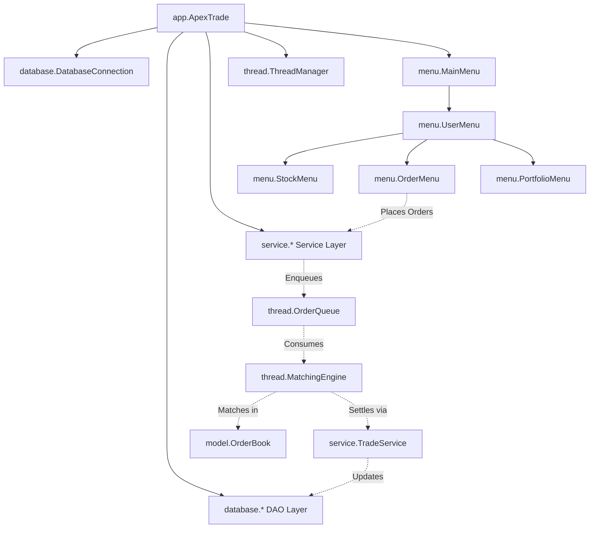

# Apex Trade — Class Architecture & Relationship Reference (`CLASSES.md`)

This document details the architectural relationships, object-oriented design hierarchies, design patterns, and package dependencies for all 42 classes in **Apex Trade**.

---

## 1. High-Level System Architecture

Apex Trade is organized into an 8-layer decoupled architecture:
1. **`app`**: Application bootstrap, dependency injection, and thread orchestration.
2. **`model`**: Domain entities representing market structures, user accounts, orders, portfolios, and order books.
3. **`exception`**: Custom checked business exceptions.
4. **`util`**: Cross-cutting utilities (formatting, validation, comparators, date helpers, constants).
5. **`database`**: Data Access Objects (DAOs) executing direct JDBC queries via `Statement` and `ResultSet`.
6. **`service`**: Business logic, input verification, financial synchronization, and transaction integrity.
7. **`thread`**: Concurrency layer containing the producer-consumer queue, matching engine, and market price simulation daemon.
8. **`menu`**: Console UI screens inheriting from an abstract base class.



---

## 2. Object-Oriented Inheritance & Interface Hierarchies

### 2.1 Interface Implementations
- **`model.Displayable`**: Implemented by:
  - `model.User`
  - `model.Stock`
  - `model.Order`
  - `model.Trade`
  - `model.Portfolio`
  *Demonstrates:* Interface contracts and polymorphic rendering in `util.TableFormatter.printTable()`.

- **`java.lang.Comparable<T>`**:
  - `model.User implements Comparable<User>` (natural ordering alphabetically by username)
  - `model.Order implements Comparable<Order>` (natural ordering chronologically by orderId)

- **`java.io.Serializable`**:
  - `model.User implements Serializable`
  - `model.Trade implements Serializable` (used for binary object serialization into `data/trades.ser`)

- **`java.lang.Runnable`**:
  - `thread.MatchingEngine implements Runnable` (executed within an independent worker thread)

- **`java.util.Comparator<Order>`**:
  - `util.BuyOrderComparator implements Comparator<Order>` (Descending price / Ascending timestamp)
  - `util.SellOrderComparator implements Comparator<Order>` (Ascending price / Ascending timestamp)

### 2.2 Class Inheritance Hierarchies

#### Console Menu Hierarchy
```
menu.AbstractMenu (Abstract Class)
   ├── menu.MainMenu
   ├── menu.UserMenu
   ├── menu.StockMenu
   ├── menu.OrderMenu
   └── menu.PortfolioMenu
```
*Demonstrates:* Abstract class design, protected fields (`scanner`, `title`, `options`), polymorphic method dispatch (`handleChoice(int choice)`).

#### Multithreading Hierarchy
```
java.lang.Thread
   └── thread.PriceFluctuationThread (Daemon thread simulating ticker drift)
```

#### Exception Hierarchy
```
java.lang.Throwable
   └── java.lang.Exception (Checked Exceptions)
         ├── exception.InsufficientFundsException
         ├── exception.InvalidOrderException
         ├── exception.UserNotFoundException
         ├── exception.StockNotFoundException
         ├── exception.DuplicateUserException
         └── exception.InsufficientSharesException
```

---

## 3. Package Dependency & Collaboration Matrix

| Package | Depends On | Exposes To | Primary Role |
|---|---|---|---|
| `model` | `util` (Comparators in `OrderBook`) | All packages | Data carriers and domain structures |
| `exception` | Core Java (`Exception`) | `service`, `database`, `menu` | Domain-specific fault reporting |
| `util` | `model` (`Displayable`, `Order`) | All packages | Reusable formatting, validation, sorting |
| `database` | `model`, `exception`, `util` | `service`, `app` | Raw SQL execution via JDBC |
| `service` | `database`, `model`, `exception`, `thread`, `util` | `menu`, `thread`, `app` | State validation and business transactions |
| `thread` | `model`, `service`, `database`, `util` | `app`, `menu` | Background order matching & price engine |
| `menu` | `service`, `model`, `thread`, `exception`, `util` | `app` | User interaction and input loop |
| `app` | All packages | None (Entry Point) | Wiring and lifecycle execution |

---

## 4. Key Design Patterns Demonstrated

1. **Singleton Pattern**:
   - `database.DatabaseConnection`: Static initialization block loads the MySQL driver; `getConnection()` manages a single active `java.sql.Connection`.
2. **Producer-Consumer Pattern**:
   - Producer: `service.OrderService.placeBuyOrder()` / `placeSellOrder()` produces limit orders into `thread.OrderQueue`.
   - Consumer: `thread.MatchingEngine` consumes orders via `consume()` using `wait()` and `notifyAll()`.
3. **Template Method / Strategy via Inheritance**:
   - `menu.AbstractMenu`: The concrete `run()` loop handles display and input reading while delegating action handling to subclass `handleChoice()`.
4. **Data Access Object (DAO) Pattern**:
   - Decouples raw SQL `Statement` and `ResultSet` mapping from higher-level business services.
5. **Comparator Pattern**:
   - `util.BuyOrderComparator` and `util.SellOrderComparator` encapsulate priority strategies for the PriorityQueue order books.
