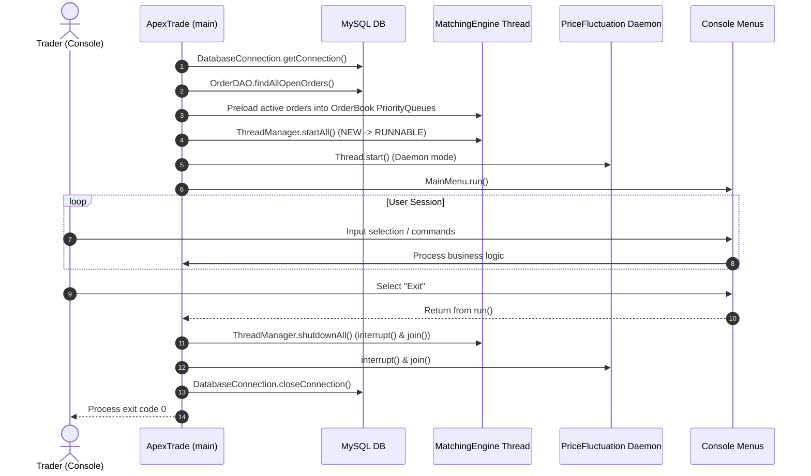
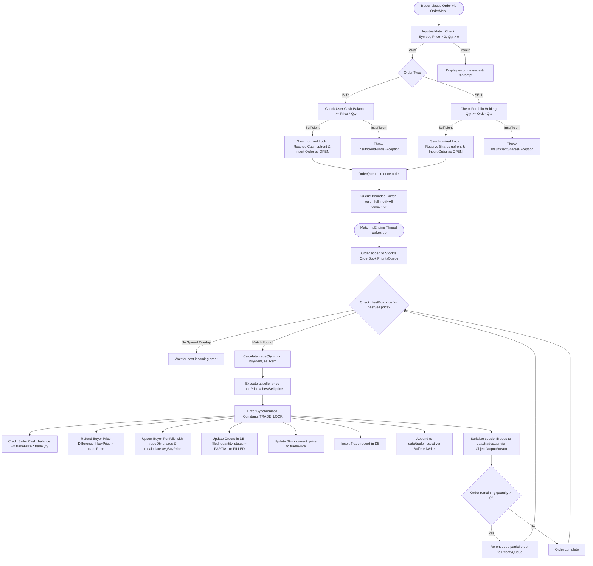

# Apex Trade — Project Flow & Runtime Execution (`PROJECT_FLOW.md`)

This document provides an end-to-end trace of Apex Trade: from initialization, menu transitions, and input validation to background thread matching, critical-section locking, and persistent ledger updates.

---

## 1. High-Level Lifecycle Flow

---

## 2. Order Placement & Matching Execution Pipeline

This is the core financial and multithreaded mechanism of Apex Trade.

---

## 3. Step-by-Step Menu Option Flows

### 3.1 Main Menu
- **Option 1: Register New Account**
  1. Prompt for username (validated: 3–50 chars).
  2. Prompt for password (validated: min 3 chars).
  3. Prompt for full legal name (validated: non-empty).
  4. Calls `UserService.register()`:
     - Checks duplicate username in `users` table. If found, throws `DuplicateUserException`.
     - Inserts record into `users` with default credit of **₹100,000.00**.
  5. Confirms account creation and displays assigned starting balance.

- **Option 2: User Login**
  1. Prompt for username and password.
  2. Calls `UserService.login()`:
     - Looks up username via `UserDAO`. If not found, throws `UserNotFoundException`.
     - Validates password via `String.equals()`. If mismatch, throws `UserNotFoundException`.
  3. On success, transitions into `UserMenu` (Trader Dashboard).

- **Option 3: Exit**
  - Exits main loop, initiating graceful thread shutdown.

---

### 3.2 Trader Dashboard (`UserMenu`)
- **Option 1: View Account Balance**
  - Calls `UserService.refreshUser()` to fetch current cash balance from DB and formats it as `INR #,##0.00`.

- **Option 2: Add Virtual Cash Funds**
  - Prompts for deposit amount. Validates `amount > 0`.
  - Multi-catch block catches `UserNotFoundException | InsufficientFundsException`.
  - Credits user balance and updates database.

- **Option 3: Explore Stock Market (`StockMenu`)**
  - **Sub-option 1: List All Listed Companies**:
    - Queries all 8 stocks via `StockDAO.findAll()`.
    - Formats output using `TableFormatter.printTable()` (symbol, company, price, prev close, change %, sector).
  - **Sub-option 2: View Stock Details & Order Book**:
    - Prompts for ticker symbol (e.g., `APEX`).
    - Displays detailed company profile.
    - Inspects `OrderBook`:
      - Clones `buyQueue` into temporary `PriorityQueue` with `BuyOrderComparator` to show top bids.
      - Clones `sellQueue` into temporary `PriorityQueue` with `SellOrderComparator` to show top asks.
      - Renders depth-of-market grid with price, total quantity, and remaining unfilled quantity.
  - **Sub-option 3: Browse Stocks by Sector**:
    - Uses `TreeMap<String, ArrayList<Stock>>` to group stocks by sector alphabetically.
  - **Sub-option 4: Back to Dashboard**.

- **Option 4: Trade & Order Desk (`OrderMenu`)**
  - **Sub-option 1: Place Limit BUY Order**:
    - Validates symbol against pre-registered set (`APEX`, `NOVA`, etc.).
    - Prompts for limit price and quantity.
    - Throws `InsufficientFundsException` if `balance < price * quantity`.
    - Atomically locks balance, reserves cash, and posts order to `OrderQueue`.
  - **Sub-option 2: Place Limit SELL Order**:
    - Validates holding quantity via `PortfolioDAO`. Throws `InsufficientSharesException` if user owns fewer shares than requested.
    - Atomically decrements portfolio shares and pushes order into `OrderQueue`.
  - **Sub-option 3: View My Order History**:
    - Fetches user orders via `OrderDAO.findOrdersByUser()`.
    - Traverses orders using `ListIterator<Order>` to render status (`OPEN`, `PARTIAL`, `FILLED`).
  - **Sub-option 4: Back to Dashboard**.

- **Option 5: My Portfolio & Trades (`PortfolioMenu`)**
  - **Sub-option 1: View Stock Holdings & P&L**:
    - Queries `PortfolioDAO.findByUser()`.
    - Calculates invested capital, current valuation, and unrealized net profit/loss percentage.
  - **Sub-option 2: View Executed Trade Log**:
    - Fetches trade settlement history via `TradeDAO.findTradesByUser()`.
  - **Sub-option 3: Back to Dashboard**.

- **Option 6: Logout**:
  - Exits dashboard and returns to top-level `MainMenu`.

---

## 4. Concurrency & Synchronization Model

1. **`Constants.TRADE_LOCK` (Intrinsic Monitor Object)**:
   - Used in `OrderService` (when reserving funds/shares) and `TradeService` (when transferring cash and shares between counter-parties).
   - Guarantees zero race conditions during parallel order placement and order matching.

2. **`thread.OrderQueue` (Bounded Buffer Monitor)**:
   - Synchronized `produce()` and `consume()` methods.
   - Producer calls `wait()` when `queue.size() >= capacity`.
   - Consumer calls `wait(1500)` when `queue.isEmpty()`.
   - Calls `notifyAll()` after state mutation to wake up complementary threads.

3. **`model.OrderBook` (Thread-Safe PriorityQueues)**:
   - Synchronized methods protect `buyQueue` and `sellQueue` from concurrent modification while background matching and foreground inspection occur.
